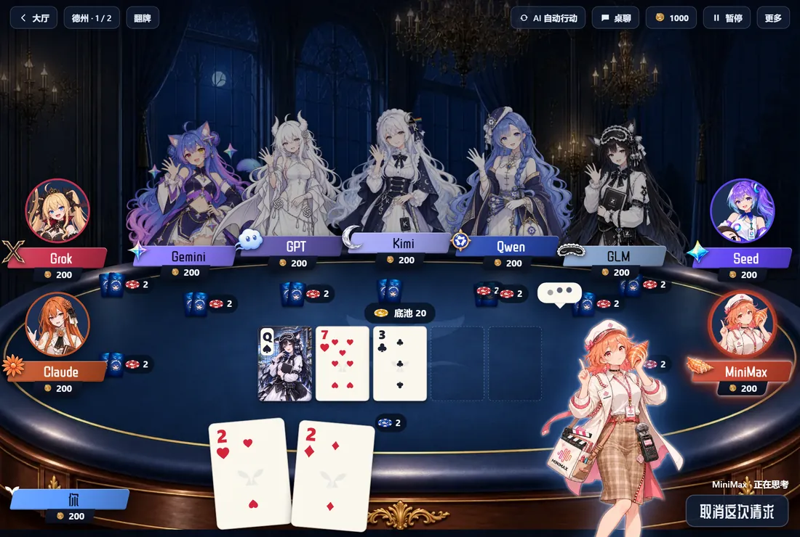
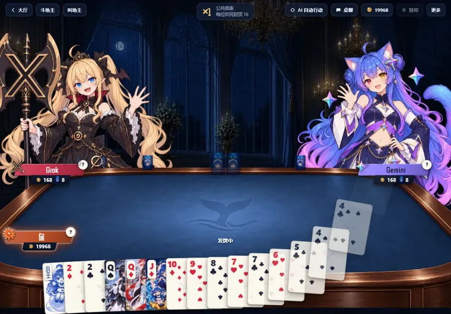
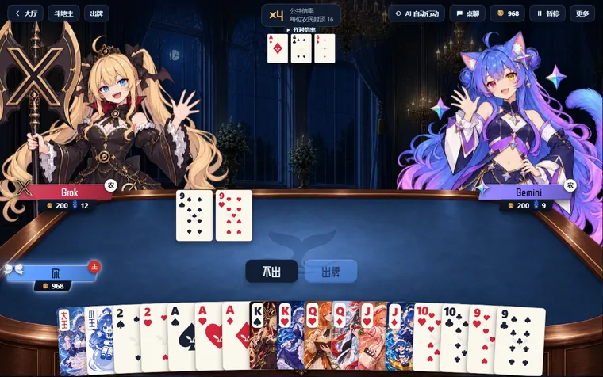
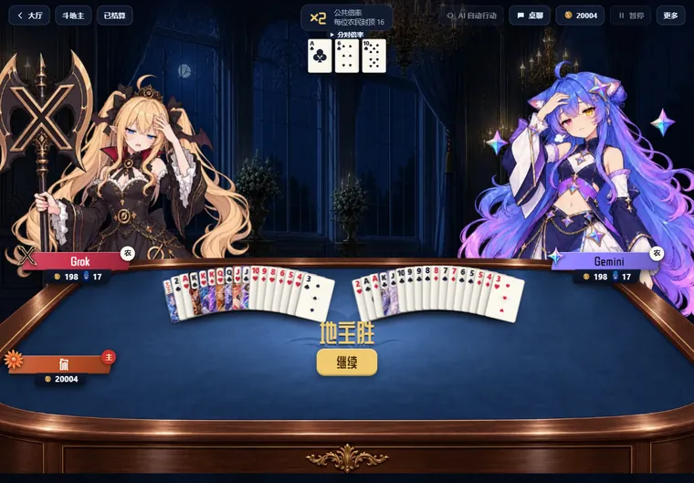
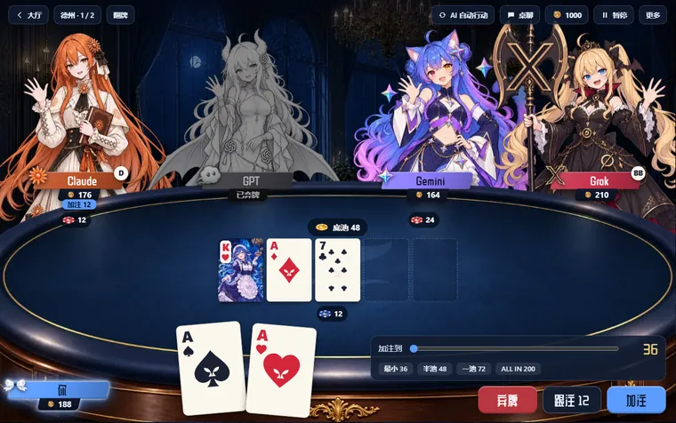
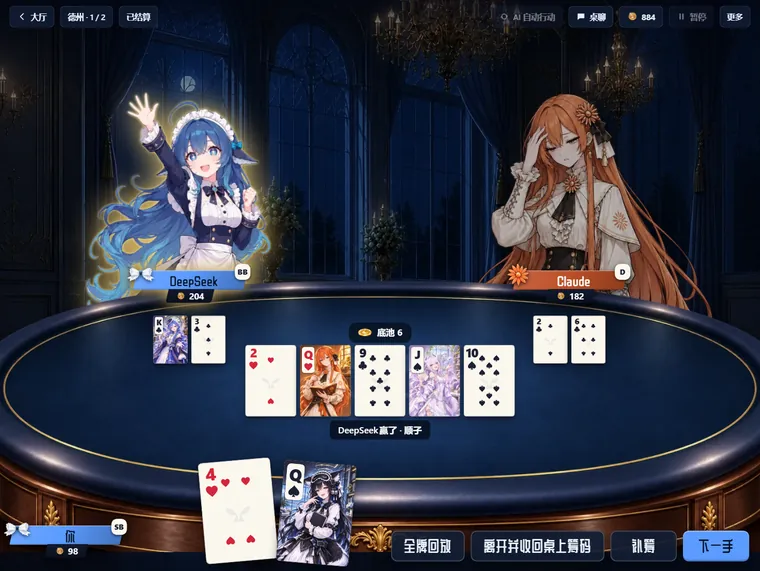

# 一起玩牌 · AI Buddy Card Games

  
  
  
  

**简体中文** · [English](#english)

[AI 酱本体](https://github.com/lXiaoSel1/AI-Buddy) · [B站陪伴](https://github.com/lXiaoSel1/AI-Buddy-Bilibili) · [QQ连接](https://github.com/lXiaoSel1/AI-Buddy-QQ) · **一起玩牌**（本仓库）

**当前版本：1.0.0** · 需要 [AI 酱](https://github.com/lXiaoSel1/AI-Buddy) 2.0.4 或更新版本，建议用 2.0.5：在 2.0.4 里，这个页面和 B站、QQ 页面切换时可能卡在「启动中」。这是 AI 酱的官方插件，在 AI 酱的 **扩展中心** 里安装，不用单独下载。

和 AI 酱里的角色打斗地主和德州扑克。她们坐在牌桌后面，用各自绑定的模型决定每一步，会换表情，也可能说一句。规则和结算由 AI 酱本体负责，模型只提出行动，不合法的行动不会执行。

## 能玩什么

- **斗地主**：三人一桌，你和两位角色。叫地主、抢地主、普通加倍、出牌，炸弹和王炸都有。底分 1，倍率来自抢地主、炸弹、王炸、春天和加倍，每位农民封顶 16。
- **德州扑克**：2 到 10 人，盲注 1/2 或 2/5，无限注，支持边池。你的带入至少 20，AI 默认带 200。两手之间可以补筹，也可以调整下一手的座位。

## 快速上手

1. 装好 AI 酱 2.0.5，并给要上桌的角色配好聊天模型。
2. 左侧栏打开 **扩展中心 → 发现**，在「一起玩牌」右边点 **安装…**，确认四项权限后启用。
3. 打开侧栏 **插件** 里的「一起玩牌」，大厅里选斗地主或德州。
4. 选牌友，点 **开始发牌**。斗地主每人至少要有 32 可用积分。
5. 轮到角色时点 **让 X 出牌**，或打开顶栏的 **AI 自动行动**。这个开关只在本次页面有效，刷新后关闭。

## 牌桌上有什么

**斗地主**：发牌时牌从桌中央发给三家，你的手牌按大王、小王、2、A 到 3 自动排好。打完后先亮牌：两位角色的剩余手牌翻开摊在桌上，你点 **继续** 才看结算。

| 发牌 | 出牌 | 亮牌 |
|---|---|---|
|  |  |  |

**德州**：公共牌一张张翻开，翻牌 3 张，转牌和河牌各 1 张。全下时依次跑完五张，再出牌型和结算。人多时顶排角色在轮到她时站起来，两端的角色从右下角现身。

| 行动条 | 摊牌结果 |
|---|---|
|  |  |

**其他**：

- **大场面演出**：斗地主的地主、飞机、炸弹、王炸、春天、反春天，德州的 ALL IN 和牌型都有演出，放的是打出这手的人。
- **表情和台词**：每步换表情。说不说话由模型决定，一句最多 40 字，不会说出手牌。
- **桌聊**：可以和在座的角色聊天。桌聊是公开的，不包含任何人的隐藏手牌，也不算出牌指令。
- **德州回放和复盘**：结算后可以看这手牌的全部底牌，也可以请某位角色复盘。斗地主没有单独的回放。
- **暂停和续玩**：牌局自动保存，随时暂停，下次从大厅继续。
- **主题和窗口**：牌背和牌桌跟随 11 套主题。页面嵌在主窗口里，随窗口缩放，也可以单独开窗口。系统开了「减少动态效果」时，动画会简化。

## 积分和好感

- 两款游戏共用 AI 酱的钱包。积分只用于游戏内，没有现金价值。
- 角色有自己的积分。余额低于 100 时，开桌或开始下一局会补到 200，每位角色每天最多 3 次。
- 斗地主开桌时先预留 32 积分，这不是入场费，结算后按实际输赢计算。德州的带入在离桌时收回。
- 和同一位角色在同一种玩法里每打完 3 局，好感 +1。
- 结算后点 **离开** 回到大厅。也可以预约本局后离开，打完再走。

## AI 怎么出牌

- 每位角色用自己绑定的模型，每一步是一次模型请求，会消耗你配置的模型额度。换绑定从下一局或下一手开始生效。
- 模型以赢牌为目标，性格只影响打法和台词。它能看到自己的手牌和公开信息，看不到别人的手牌。
- 不合法的行动会退回让模型重答，最多 2 次；还不行就暂停牌局，不会替她随便出牌。
- 等待时能看到是在排队、思考，还是在重答。超过 30 秒会提示，你可以继续等，也可以取消。
- 连续 120 秒收不到模型的数据算超时，牌局会暂停，恢复后可以重新请求。取消不算失败，牌局继续。

## 数据与权限

安装时要确认四项权限：

| 权限 | 用途 |
|---|---|
| 牌桌 | 开桌、行动、暂停、补筹、离桌 |
| 模型 | 用角色绑定的模型决定她的行动 |
| 桌聊 | 公开桌聊和回复 |
| 复盘 | 查看已结算的德州手牌，请角色复盘 |

牌局、积分和好感都存在你本机的 AI 酱里。插件页面不能直接读数据库，也不能改积分，只能发出牌桌操作，由本体校验后执行。隐藏手牌只在结算后公开：德州是摊牌和回放，斗地主是亮牌。

## 已知限制

- 需要 AI 酱 2.0.4 或更新版本。旧版本会提示需要升级。
- 流程用合成模型在真实窗口里走通过，包括官方安装和完整牌局。真实模型打得好不好、台词是否合适、要等多久，取决于你接的模型，没有做过完整验收。
- 斗地主没有单独的回放，也没有练习桌。
- 只支持 Windows 10/11 x64。

## 技术说明

插件包名 `@ai-buddy/card-games`，版本 1.0.0，需要本体的 `voice-games-v1` 能力。这个仓库包含插件源码，页面入口 `plugins/card-games/src/client`，规则在 `plugins/card-games/src/rules`。积分、结算、牌局存档和模型调用在 [AI 酱本体](https://github.com/lXiaoSel1/AI-Buddy)里。

## 许可与第三方

源码公开，采用 Apache-2.0 + Commons Clause，见 [LICENSE.md](LICENSE.md)。可以免费使用、修改和分享，不能出售。素材和字体的来源与条件见 [THIRD-PARTY-NOTICES.md](THIRD-PARTY-NOTICES.md)：人物牌以 AI 酱现有角色作参考，适用这些角色美术的条件。

---

## English

**Version 1.0.0** · requires [AI Buddy](https://github.com/lXiaoSel1/AI-Buddy) 2.0.4 or later. Use 2.0.5 if you can: in 2.0.4 this page can stick on "Starting" when you switch from the Bilibili or QQ page. It is an official AI Buddy plugin, installed from the **Extensions** center, so there is nothing to download separately.

Play Dou Dizhu and Texas Hold'em with your AI Buddy characters. They sit behind the table, use their own bound models to decide each move, change expressions and sometimes say a line. The app handles rules and settlement. A model can only propose a move, and an illegal move is never played.

### What you can play

- **Dou Dizhu**: three players, you and two characters. Calling, robbing, ordinary doubling and playing, with bombs and the rocket. Base score 1. The multiplier comes from robbing, bombs, the rocket, spring and doubling, capped at 16 per farmer.
- **Texas Hold'em**: 2 to 10 players, blinds 1/2 or 2/5, no limit, with side pots. Your buy-in is at least 20, and AI players bring 200 by default. You can top up and change next-hand seats between hands.

### Quick start

1. Install AI Buddy 2.0.5 and give the characters you want at the table a chat model.
2. Open **Extensions → Discover**, click **Install…** next to Card Games, confirm the four permissions and enable it.
3. Open Card Games under **Plugins** in the sidebar and pick a game in the lobby.
4. Pick your opponents and click **Deal**. Dou Dizhu needs at least 32 available points per player.
5. On a character's turn, click **Ask X to play**, or turn on **AI auto** in the top bar. That switch lasts until the page is refreshed.

### At the table

**Dou Dizhu**: cards are dealt from the middle of the table, and your hand sorts itself from the jokers and 2 down to 3. After the last play the characters' remaining cards are turned face up, and the results appear only after you click **Continue**.

**Texas Hold'em**: board cards turn over in order, three on the flop and one each on the turn and river. An all-in runs out street by street before the hand ranking and results. At a full table, a top-row character stands up on her turn, and an end-seat character appears at the lower right.

**Also**:

- **Big moments**: landlord, plane, bomb, rocket, spring and counter-spring in Dou Dizhu, ALL IN and hand rankings in Hold'em, showing whoever played it.
- **Expressions and lines**: expressions change on every move. The model decides whether to speak, in 40 characters at most, and never names hidden cards.
- **Table chat**: public chat with the seated characters. It contains nobody's hidden cards and never counts as a move.
- **Hold'em replay and review**: after settlement you can see every hole card of that hand and ask a character to review it. Dou Dizhu has no separate replay.
- **Pause and resume**: games save automatically, and you can resume from the lobby.
- **Themes and windows**: card backs and tables follow the 11 themes. The page sits in the main window and scales with it, or opens in its own window. Animations simplify when the system's reduced motion setting is on.

### Points and affection

- Both games share the AI Buddy wallet. Points are for use in the games and have no cash value.
- Characters have their own points. When a character is below 100, she is topped up to 200 when a table opens or a new game starts, up to 3 times a day.
- Dou Dizhu reserves 32 points when the table opens. This is not an entry fee: settlement follows the real result. Hold'em chips return when you leave.
- Every 3 games with the same character in the same game type add 1 affection.
- Click **Leave** after settlement to return to the lobby, or choose to leave after the current game.

### How the AI plays

- Each character uses her own bound model, one model request per move, which uses the model quota you configured. A new binding takes effect from the next game or hand.
- Models aim to win, and personality only shapes style and lines. A model sees its own cards and public information, never other players' cards.
- An illegal move goes back to the model up to 2 times. After that the table pauses. Nothing plays for her at random.
- While waiting you can see whether the request is queued, thinking or retrying. After 30 seconds a note says you can keep waiting or cancel.
- If no data arrives for 120 seconds the request times out and the table pauses. You can resume and ask again. Cancelling is not a failure, and the game carries on.

### Data and permissions

Installation asks for four permissions: tables (open, act, pause, top up, leave), models (use a character's bound model for her moves), chat (public table chat) and replay (view settled Hold'em hands and ask for a review).

Games, points and affection stay in AI Buddy on your computer. The plugin page cannot read the database or change points. It can only send table commands, which the app validates. Hidden cards become public only after settlement: at showdown or in replay for Hold'em, and in the reveal step for Dou Dizhu.

### Known limitations

- Requires AI Buddy 2.0.4 or later. Older versions show an upgrade notice.
- The flow has been run in a real window with a synthetic model, including official installation and full games. Playing strength, lines and waiting times depend on your model and have not had a full review.
- Dou Dizhu has no separate replay and no practice table.
- Windows 10/11 x64 only.

### Technical notes

Package `@ai-buddy/card-games` 1.0.0, requires the app's `voice-games-v1` feature. This repository holds the plugin source: the page in `plugins/card-games/src/client` and the rules in `plugins/card-games/src/rules`. Points, settlement, saved games and model calls live in the [AI Buddy app](https://github.com/lXiaoSel1/AI-Buddy).

### License and third parties

Source available under Apache-2.0 + Commons Clause, see [LICENSE.md](LICENSE.md). You may use, modify and share it for free, but not sell it. See [THIRD-PARTY-NOTICES.md](THIRD-PARTY-NOTICES.md) for artwork and font sources: character cards use existing AI Buddy characters as references, and the terms for that artwork apply.
